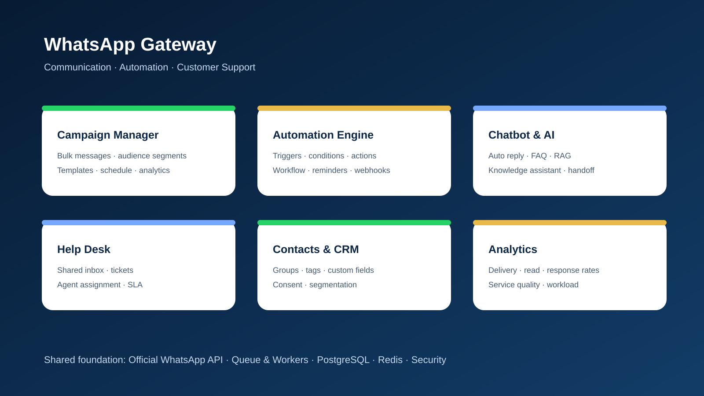
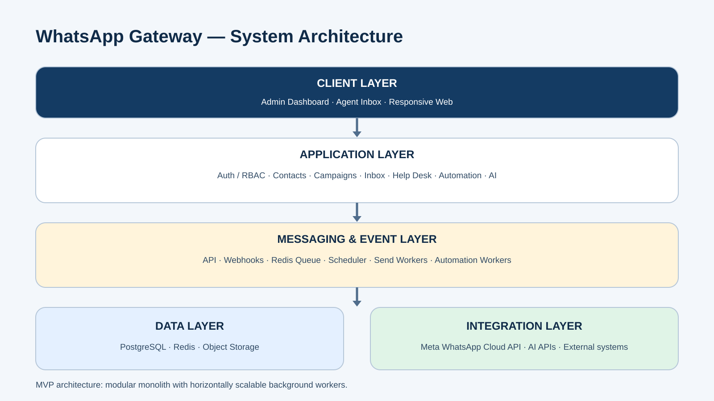
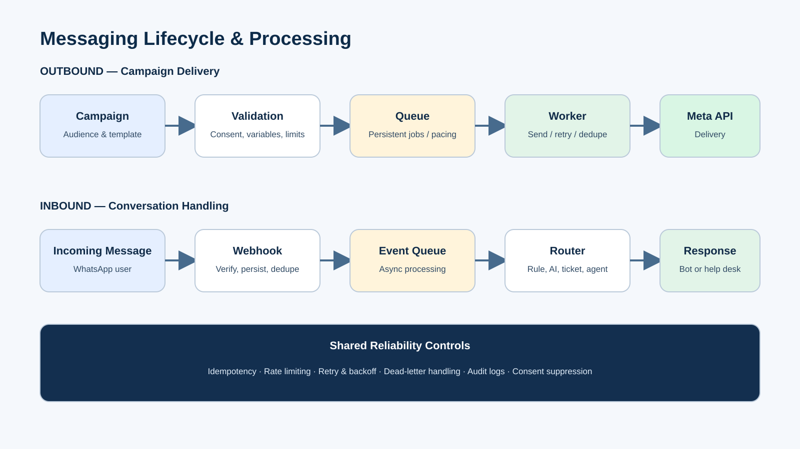

# Visual References

The visual previews displayed in the original conversation were search-preview images and were not available as original downloadable assets. This repository therefore includes recreated vector references (SVG) based on the same concepts—not exact copies of those transient images.

## Product modules

## System architecture

## Messaging lifecycle

These assets are source-controlled, scalable, and editable SVG files.
